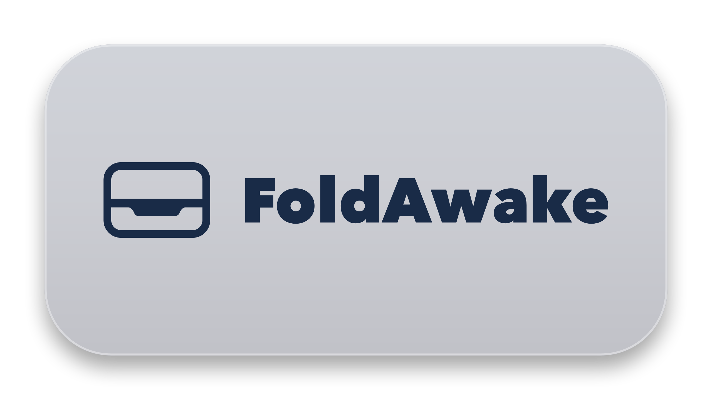

  
    
  
  
  
  
  [-success?style=for-the-badge)](https://modolabs.gumroad.com/l/ttmmisw)

 

# FoldAwake

> **Run your MacBook with the lid closed. Zero bloat, zero background drain.**

macOS normally puts your laptop to sleep the moment you shut the lid unless you're plugged into power, an external display, and a mouse. 

**FoldAwake** gives you a lightning-fast, one-click toggle in your menu bar that lets your Mac keep running heavy downloads, 3D slicing, video renders, audio playback, and code tasks with the lid closed—on battery or wall power, with no external display needed.

---

## ✨ Key Features

- ⚡ **True Clamshell Mode:** Shut your MacBook lid while on battery or power without triggering sleep. Keeps tasks alive on the move.
- 🎯 **1-Click Menu Bar Control:**
  - **Outline Clamshell:** Inactive (normal macOS sleep when closed).
  - **Solid White Clamshell:** Active (laptop stays awake and working with lid shut).
- ⏏️ **1-Click Safe Disk Ejection:** Right-click the menu bar icon to safely unmount all external USB/Thunderbolt drives before packing your laptop into your bag.
- 🛡️ **Runaway Battery Watchdog:** Automatically detects orphaned background processes (e.g. runaway browser tabs or frozen video engines) and terminates them to prevent unexpected battery drain.
- 🍃 **Native AppKit Engineering:** Written directly in Objective-C. Sits at 0.0% CPU overhead, uses under 15MB RAM, and never drains battery in the background.

---

## 📦 Download & Installation

FoldAwake is distributed directly outside the Mac App Store as a signed Universal Binary:

1. **[Download FoldAwake on Gumroad ($2.99+)](https://modolabs.gumroad.com/l/ttmmisw)**
2. Open the downloaded `FoldAwake-1.0.dmg`.
3. Drag `FoldAwake.app` into your Applications folder.
4. Click the clamshell icon in your menu bar anytime to toggle!

---

## 🛡️ 30-Day Money-Back Guarantee

If FoldAwake does not perform flawlessly on your specific Mac hardware setup, simply send an email for an instant 100% refund, no questions asked.

---

## 💬 Feedback & Feature Requests

Have a suggestion, found an edge case, or want to report a bug?
- **[Open an Issue](https://github.com/alaska14/foldawake/issues)** right here on GitHub.
- Or reach out directly at **[modolabs.gumroad.com](https://modolabs.gumroad.com)**.

Crafted with care by **Modo Labs**.
